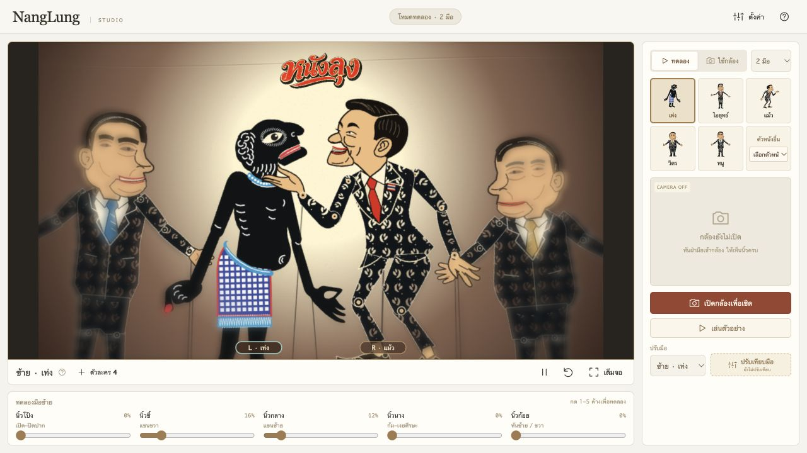

# ฉากผ้า แสงกลางเวที และตัวละครหลายตัว

31 ตุลาคม 2026

## การใช้งาน

1. รายการด้านข้างแสดงครบ 6 แบบทันที: เท่ง ไอยุทธ์ แม้ว วิตร หนู และเอก เลือก checkbox ซ้าย/ขวาบนการ์ดเพื่อแสดงตัวนั้น หรือคลิกภาพเพื่อเลือกเชิดโดยตรง
2. **คลิกที่ตัวละครบนเวทีหรือการ์ดในรายการ** เพื่อเลือกเชิด ฝั่งซ้ายใช้มือซ้าย ฝั่งขวาใช้มือขวาเสมอ ทั้งโหมดหนึ่งมือและสองมือ ส่วนตัวก่อนหน้าคงท่าเดิม
3. โหมด **2 มือ** ควบคุมตัวที่เลือกฝั่งละหนึ่งตัวพร้อมกัน เช็กมือใต้เวทีเพื่อเปิด/พักแต่ละข้าง ตัวอื่นเป็นตัวประกอบคงท่า
4. เลือกฝั่งบนการ์ดเพื่อย้ายตัว หรือเอาเครื่องหมายออกเพื่อซ่อน เวทีว่างทั้งหมดได้ ตัวซ้ำของแบบที่ยังใช้งานอยู่จะคงอยู่ ดู [UX/UI รุ่นใหม่](UX_REDESIGN.md)
5. บนคีย์บอร์ด โฟกัสเวทีแล้วใช้ลูกศรซ้าย–ขวาสลับตัวที่แสดงอยู่ หรือคลิกภาพในรายการเพื่อเลือกเชิด
6. ลากตัวละครบนเวทีเพื่อจัดตำแหน่ง ข้ามกลางเวทีเพื่อย้ายฝั่ง ตัวที่กำลังเชิดจะย้ายไปใช้มือฝั่งใหม่ ตำแหน่งบันทึกหลังปล่อยและยังอยู่เมื่อโหลดใหม่ กด Esc หรือยกเลิก pointer เพื่อคืนตำแหน่งก่อนลาก
7. ลำดับซ้อนทับอิงตำแหน่งปัจจุบัน: ตัวที่อยู่ใกล้ริมซ้ายหรือขวามากกว่าจะอยู่ด้านหน้า ลำดับเปลี่ยนตามการลากและการขยับมือ การเลือกเชิดไม่เปลี่ยนลำดับนี้ และการคลิกส่วนที่ซ้อนกันจะเลือกตัวด้านหน้า

เวทีเริ่มจากคู่ที่บันทึกไว้เดิม ระบบเก็บรายการตัวละคร ฝั่ง ท่า และการผูกมือแยกจากโปรไฟล์ปรับเทียบ การเลือกตัวใหม่ไม่ล้างโปรไฟล์นิ้ว และนิ้วก้อยที่ค้างอยู่จะต้องปล่อยก่อนกลับด้านตัวใหม่ ขณะรับมือครั้งแรกหลังสลับจะปรับจุดอ้างอิงเพื่อลดการกระโดดของตำแหน่ง

เปิดกล้องจากเมนูขวา ภาพพรีวิวจะอยู่มุมล่างขวาของพื้นที่ฉากจริง รวมกรณีมีขอบดำหรือปรับขนาดหน้าจอ เบลอเฉพาะพรีวิวเล็กน้อย ภาพที่ส่งตรวจจับและหน้าปรับเทียบยังใช้ต้นฉบับ ปิดกล้องแล้วหน้าต่างภาพจะซ่อน ปุ่มปรับเทียบอยู่ใต้ปุ่มกล้องตลอด ไม่ต้องสลับแท็บ

## รูปลักษณ์ตามภาพอ้างอิง

- ใช้ภาพโรงหนังที่ผู้ใช้แนบเป็นแนวทาง: ผ้าสีครีม แสงเหลืองสว่างกลางเวที ขอบน้ำตาลเข้ม รอยทอและตะเข็บผ้า ล็อกขนาดตัวละครเท่าตัวกลางในภาพอ้างอิง (scale 1.02) ไม่ย่อตามจำนวน จัดตัวละครฝั่งเดียวกันเป็นกลุ่มชิดขึ้นและเห็นเท้าในฉาก
- วาดฉากด้วย Canvas พร้อมเกรนคงที่ ความคมชัดอยู่ที่แต่ละตัวละคร: หัวคมชัดแล้วค่อย ๆ ไล่เบลอจากใต้หัวลงถึงขา ช่วงล่างขยายต่อเนื่องสูงสุด 7% ตามระดับความเบลอ โดยรักษาแนวเท้า ไม่เบลอหัวเพราะอยู่ริมเวที โลโก้และป้ายมือคงความชัด
- ตัวละครฝั่งซ้ายหันเข้าไปทางขวา และฝั่งขวาหันเข้าไปทางซ้ายเมื่อเพิ่มหรือย้ายฝั่ง นิ้วก้อยยังกลับด้านได้เอง การขยับมือเลื่อนตัวภายในพื้นที่จากตำแหน่งตั้งต้น
- ช่องโปร่งในรูปหนังยังมองเห็นฉากด้านหลังได้ การคลิกตรวจพิกเซลตัวหนังจริง โดยคำนวณกลับทั้งการหมุน การขยายช่วงล่าง การกลับด้าน และขอบดำของ Canvas
- เก็บภาพตัวที่พักไว้ใน cache และปล่อย buffer เมื่อนำตัวนั้นออก ฉากที่ไม่มีการเปลี่ยนแปลงไม่ต้องวาดซ้ำ



## โลโก้ PNG ใหม่

ไฟล์ใช้งานคือ [nanglung-logo.webp](../public/branding/nanglung-logo.webp) (สร้างจาก `art/branding/nanglung-logo-transparent.png` ด้วย `scripts/build-web-images.py`) สร้างด้วย **imagegen built-in tool** จากโลโก้เดิม เป็น PNG RGBA ขนาด 1774×887 มี alpha โปร่งใสจริง ไม่ได้วาดพื้นกระดาษหรือกรอบป้ายทับฉาก ไฟล์โลโก้เดิมเก็บไว้เป็นต้นแบบ

พรอมป์ต์ที่ใช้:

```text
Use case: background-extraction. Asset: transparent PNG logo for the top center of a Southern Thai shadow puppet theatre. Recreate the attached Thai lettering logo as a clean standalone transparent cutout, text exactly 'หนังลุง'. Preserve its distinctive red-orange hand painted Thai lettering, ivory/gold outlines, black offset shadow and long sweeping underline. Match the reference shape and spelling faithfully. Remove ALL cream paper/background outside the logo, including enclosed background gaps between the lettering and underline, to real alpha transparency. Keep ivory edges belonging to the letters. Wide horizontal composition, logo fills canvas with small even padding. No plaque, frame, backdrop, checkerboard, extra text or objects.
```

ภาพโรงหนังอ้างอิงใช้ศึกษาบรรยากาศ ไม่ได้นำภาพตัวละครจากภาพนั้นมาเพิ่มในคลัง

## การตรวจ

Vitest 77 กรณีผ่าน ครอบคลุมการเพิ่มซ้ำ เก็บและอ่านเวที ตรวจข้อมูลเสีย ลบตัวที่ผูกมือ เลือกตัวที่อีกมือคุมอยู่ คลิกข้ามฝั่งในโหมดมือเดียว พิกัดคลิกหลังหมุน/กลับด้าน และการสลับมือโดยไม่รับคำสั่งก้อยค้าง

หน้าทดสอบ `tests/cast-renderer.html` ตรวจการคลิกตัวหมุนทั้งสองทิศ คลิกขอบดำไม่เลือกตัว และตัวที่ลบไม่เหลือพื้นที่กด ทดสอบวาด 12 ตัวโดยเก็บเวลาเฉพาะส่งคำสั่งวาด จึงไม่ใช้ค่านั้นอ้างเป็น FPS หรือเวลาถึงจอ

ตรวจผ่าน UI จริง: เพิ่มครบ 12 ตัว แบ่งข้างละ 6 ตัว ปุ่มเพิ่มหยุดที่ขีดจำกัด รีโหลดแล้วได้รายการเดิม ลบกลับเหลือสี่ตัว ย้ายฝั่ง และคลิกสลับเท่ง–แม้วโดยเท่งคงท่าปากที่ตั้งไว้ ตรวจหน้าและ dialog ที่ 320×480, 375×812, 568×320, 844×390, 1366×768 ไม่มี scroll หรือปุ่มหลักล้นจอ การเชิดมือจริงผ่านกล้องยังควรตรวจบนเครื่องแสดงจริง โดยเฉพาะเมื่อมือไขว้หรือบังกัน
