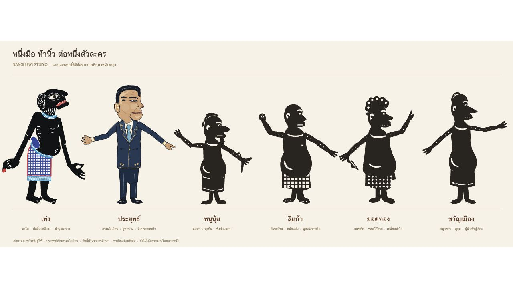

# ชุดหลัก เท่ง–ไอยุทธ์–แม้ว–วิตร–หนู

> แบบล่าสุดของสี่ตัวร่วมสมัยเปลี่ยนเป็น PNG ที่ผู้ใช้ส่งใหม่ ดู [USER_CHARACTER_ART.md](USER_CHARACTER_ART.md) เอกสารด้านล่างเก็บแนวทางชุดเวกเตอร์รุ่นก่อน

แนวทางและแบบใช้งานใน NangLung Studio · 31 ตุลาคม 2026

## หลักการออกแบบ

ใช้ภาพเท่งและภาพตัวหนังสูทฉลุที่ผู้ใช้แนบเป็นแนวทางร่วม รักษาความรู้สึกของตัวหนังแบน เส้นรอบรูปชัด ศีรษะอ่านง่ายจากระยะไกล รอยฉลุที่แสงผ่านได้ หมุดข้อต่อ และก้านเชิด ให้รูปหน้า สัดส่วน สีเนกไท และท่าพักแยกตัวละครออกจากกัน

งานช่างแกะรูปหนังตะลุงมีการแกะและฉลุรูปบนแผ่นหนัง ลงสี และประกอบก้านเชิด ศึกษาจาก [SACIT: แกะรูปหนังตะลุง](https://archive.sacit.or.th/handicraft/4) ส่วนบทบาทตัวตลกและความผูกพันกับท้องถิ่นดู [นิทรรศการ ม.อ.](https://archive.clib.psu.ac.th/online-exhibition/talung/page7.html) และ [กรมส่งเสริมวัฒนธรรม: มรดกวัฒนธรรมภาคใต้ หนังตะลุง](https://www.culture.go.th/culture_th/ewt_news.php?filename=index&nid=6372)

นำมาตีความเป็นงานดิจิทัล: รูปแบนสองมิติ ลายเถาใบและจุดฉลุที่วาดขึ้นใหม่ แขนบน–ปลายแขนต่อด้วยหมุด และก้านบนเวที ชุดสูทลายฉลุของสี่ตัวร่วมสมัยออกแบบตามภาพแนบ ไม่อ้างว่าเป็นเครื่องแต่งกายดั้งเดิมของตัวตลกใต้ทุกตัว

## แบบรายตัว

| ชื่อบนเวที | บุคคลต้นแบบ | เอกลักษณ์ภาพ | เครื่องแต่งกาย / ท่าทดลอง |
| --- | --- | --- | --- |
| 1 เท่ง | ภาพเท่งที่ผู้ใช้ให้ | ตัวดำ ตาโต จมูกเด่น สร้อยฟ้า มือชี้ปลายแดงและมือวง | ผ้านุ่งตารางน้ำเงินตามภาพเดิม ชี้ประกอบคำ |
| 2 ไอยุทธ์ | ประยุทธ์ จันทร์โอชา | ผมแสกสั้น คิ้วเข้ม แก้มและคางเด่น ลำตัวค่อนข้างตรง | สูทหนังดำฉลุ ขอบทอง เนกไทแดง มือชี้สลับผายมือ |
| 3 แม้ว | ทักษิณ ชินวัตร | ผมปัดเป็นคลื่น ยิ้มตาหยี หูและแก้มชัด ขางอตามแบบก่อนหน้า | สูทหนังดำฉลุ เนกไทแดง ผายมือรับคำ ปรับชุดใหม่จากแบบผ้าคาดเอวเดิม |
| 4 วิตร | ประวิตร วงษ์สุวรรณ | รูปร่างป้อม ศีรษะกลม แก้มเต็ม ตาหรี่ เปิดหน้าผาก | สูทฉลุ เนกไททอง ท่ายกมือกระชับใกล้ตัว |
| 5 หนู | อนุทิน ชาญวีรกูล | รูปร่างสูงกว่า วิตร ไหล่กว้าง คิ้วหนา ผมสั้น กรามกว้าง | สูทฉลุ เนกไทคราม ท่าผายมือกว้าง |

ศึกษารูปหน้าจากภาพใน Parliament Watch / WeVis: [ประวิตร](https://parliamentwatch.wevis.info/politicians/d5409bcf-f304-423e-9079-a593b9ef5dbd), [อนุทิน](https://parliamentwatch.wevis.info/politicians/4cc8dfaf-e5ce-41f4-94d3-53bf858308b4), [ประยุทธ์](https://parliamentwatch.wevis.info/politicians/62d24a30-9b4d-49f1-826c-0e2168ad798d) ภาพถ่ายต้นทางไม่ได้รวมเป็น asset เว็บไซต์ รูปหน้าเป็นเวกเตอร์ล้อเลียนวาดใหม่ สีและท่าสาธิตเป็นการออกแบบ ไม่อ้างถึงคำพูดหรือพฤติกรรมจริงของบุคคล

เท่งคงรูปตามภาพผู้ใช้ อีกสี่ตัวเป็นตัวละครล้อเลียนร่วมสมัยตามคำขอ ไม่จัดเป็นตัวตลกดั้งเดิม งานนี้ยังไม่ได้ตรวจทานโดยครูหนัง การรับรองขนบในระดับคณะหนังควรให้ครูหนังหรือนายหนังร่วมทบทวนรูปและลีลา

## การใช้ในระบบ

- แผงหลักมีห้าตัวตามลำดับ และช่อง “ตัวหนังอื่น” สำหรับหนูนุ้ย สีแก้ว ยอดทอง ขวัญเมือง รวม 9 ตัวเลือก โดยไม่เพิ่มแถวจนหน้าเว็บต้องเลื่อน
- หนูและหนูนุ้ยเป็นคนละตัว มี ID `anutin` และ `nunui` แยกกัน ไอยุทธ์และแม้วยังใช้ ID `prayut` และ `thaksin` เพื่อให้ตัวละครที่บันทึกไว้เดิมใช้ต่อได้
- หนึ่งมือควบคุมหนึ่งตัว: โป้งเปิดปาก ชี้/กลางขยับแขน นางก้มเงย ก้อยค้างกลับซ้ายขวา เลือกโหมดสองมือเพื่อเชิดสองตัวพร้อมกัน
- ลายฉลุเป็นช่องโปร่งจริงในแต่ละชิ้นและติดไปกับข้อต่อ ใช้ข้อมูลเดียวกันใน Canvas กับ SVG หมุดข้อมือไม่หลุดจากมือเมื่อยกแขน
- หัวและกรามแยกเพื่อระบบดิจิทัล ขาเป็นท่าคงที่ที่เคลื่อนตามลำตัว ไม่ได้เพิ่มการควบคุมขาแยกด้วยนิ้ว
- `src/leather-style.ts` สร้างลายร่วม ส่วนวิตรและหนูใช้ PNG จากผู้ใช้ผ่าน `src/user-puppets.ts` ดาวน์โหลด SVG รายตัวจากปุ่มชื่อตัวละครใต้เวที

ไฟล์เวกเตอร์รวม: [characters-sheet.svg](characters-sheet.svg)
