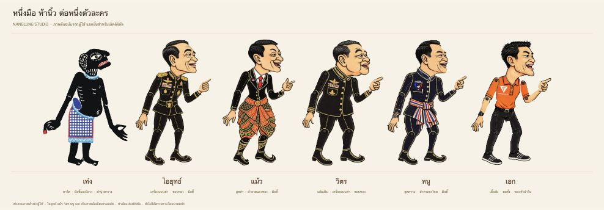

# ตัวละครจาก PNG ชุดใหม่ของผู้ใช้

1 พฤศจิกายน 2026 · แบบใช้งานล่าสุดของตัวละครลำดับ 2–6

| ลำดับ | ชื่อบนเวที | บุคคลต้นแบบ | แบบที่ใช้ |
| --- | --- | --- | --- |
| 2 | ไอยุทธ์ | ประยุทธ์ จันทร์โอชา | เครื่องแบบดำ ขอบทอง อินทรธนู แถบสี และเข็มขัด |
| 3 | แม้ว | ทักษิณ ชินวัตร | สูทดำ เนกไทแดง ผ้านุ่งลายแดงทองเขียว และรองเท้าปลายงอน |
| 4 | วิตร | ประวิตร วงษ์สุวรรณ | รูปร่างป้อม แก้มเต็ม เครื่องแบบดำ ขอบทอง |
| 5 | หนู | อนุทิน ชาญวีรกูล | ชุดคราม ตราหน้าอก ผ้าคาดเอวสีธงไทย และนาฬิกา |
| 6 | เอก | ธนาธร จึงรุ่งเรืองกิจ | ผมตั้ง เสื้อโปโลสีส้มพร้อมโลโก้จากภาพ นาฬิกา และรองเท้าผ้าใบ |

ใช้ภาพทั้งสี่ที่ผู้ใช้ส่งพร้อมข้อความ “gen ใหม่มาแล้ว ใช้แบบอันนี้เลย” เป็นชิ้นงานจริง โดยจับคู่ตามบุคคลและชุดในภาพ เท่งยังใช้แบบที่ให้ไว้ก่อนหน้า ชื่อและ ID ทั้งหมดคงเดิม ทำให้ตัวที่จัดบนเวทีและโปรไฟล์มือเดิมใช้ต่อได้

เพิ่มเอกตามภาพแนบวันที่ 1 พฤศจิกายน 2026 ใช้ ID `thanathorn` แสดงในรายการหลังหนู เลือกฝั่งและเชิดได้เหมือนตัวอื่น โดยไม่เพิ่มลงฉากเดิมอัตโนมัติ

## ไฟล์ต้นฉบับ

ไฟล์ PNG ขนาด 1024×1536 เก็บที่ `public/characters/artwork/` ใช้ต้นฉบับโดยตรง ไม่เปลี่ยนพิกเซลของไฟล์ สี่ภาพแรกเป็น RGBA ส่วนเอกเป็น RGB ที่มีพื้นขาว:

| ไฟล์ | SHA-256 |
| --- | --- |
| [prayut.png](../public/characters/artwork/prayut.png) | `8e9270fe6e1fa79e680b6f7588ed30a5f34801782119c87cceb95db0bf1c6fa6` |
| [thaksin.png](../public/characters/artwork/thaksin.png) | `0c03025b012a2ff0cd18ad395feaa2807baa9207e63df3806a72f044564dbb5e` |
| [prawit.png](../public/characters/artwork/prawit.png) | `2b411c9edd9b1d0b312cd4606ccc7cb8b3fc970d9841245c882542012c008566` |
| [anutin.png](../public/characters/artwork/anutin.png) | `2725897d173496ebd8b4f69bccd9dff77a5ae9560eb4e9e1c6f57d4be0d3bf2c` |
| [thanathorn.png](../public/characters/artwork/thanathorn.png) | `08b7861905dc8322f7fbe7ba83818d00b603a77bc1425bb3542f95ceb7071f51` |

## การเชิด

`src/user-puppets.ts` กำหนดหน้ากากแยกศีรษะ กราม แขนบน ปลายแขน และมือ โดยใช้ภาพเดิมบนทุกชิ้น ข้อต่ออ้างอิงหมุดที่อยู่ในภาพ ส่วนลำตัว ผ้านุ่ง และขาเป็นชิ้นคงที่ รอยพื้นหลังนอกตัวไอยุทธ์ถูกตัดด้วยหน้ากากแสดงผล ไฟล์ต้นฉบับยังอยู่ครบ

เอกใช้หน้ากากเวกเตอร์จากพื้นขาวที่เชื่อมถึงขอบภาพ เก็บไว้ใน `src/thanathorn-mask.ts` สร้างด้วย `scripts/trace-artwork-background.py` พื้นนอกตัวและช่องระหว่างขาโปร่งใส ส่วนสีขาวที่อยู่ภายในเส้นรอบรูป เช่น โลโก้และพื้นรองเท้ายังคงอยู่ หน้ากากเดียวกันติดไปกับทุกชิ้นเมื่อหมุนข้อต่อ และใช้ทั้ง Canvas กับ SVG

หนึ่งมือยังสั่งปาก แขนสองข้าง ศีรษะ และกลับด้านด้วยก้อย การเปิดกรามเพิ่มจากท่าปากที่มีอยู่ในภาพ จึงยังเห็นสีหน้าตามต้นฉบับเมื่อปล่อยนิ้ว ขาไม่มีการควบคุมแยก

Canvas และ SVG ใช้หน้ากากและตำแหน่งหมุนชุดเดียวกัน ภาพท่าพักใช้ตำแหน่งที่ชิ้นส่วนทุกชิ้นตรงกับภาพต้นฉบับ ส่วนภาพบนเวทีอาจกลับด้านตามฝั่งหรือคำสั่งก้อย

ไฟล์ดาวน์โหลด [prayut.svg](../public/characters/prayut.svg), [thaksin.svg](../public/characters/thaksin.svg), [prawit.svg](../public/characters/prawit.svg), [anutin.svg](../public/characters/anutin.svg), [thanathorn.svg](../public/characters/thanathorn.svg) ฝัง PNG ไว้ในตัว เปิดแยกจากเว็บไซต์ได้ เป็น SVG ที่มีภาพ raster และหน้ากากข้อต่อ รายละเอียดภาพยังเป็นพิกเซลตามต้นฉบับ

ภาพพรีวิวในแอปใช้ SVG แบบ inline เพื่อใช้ PNG ร่วมกับ Canvas และโหลดภาพต้นฉบับเพียงชุดเดียว ข้อมูลภาพไม่ถูกรวมเป็น base64 ซ้ำในทุกปุ่ม

## การตรวจ

- Vitest 114 กรณีผ่าน รวม checksum และขนาดไฟล์จริง ความตรงกันของภาพทุกชิ้นที่ท่าพัก แหล่งภาพเพียงหนึ่งชุดต่อ SVG และการอ้างอิง clip/mask ที่ครบ
- ตรวจท่า 0%, 50% กลับด้าน และ 100% ของทุกตัว รวมปาก ศีรษะ และแขน และดูบนฉากผ้าโหมดหลายตัว
- สลับตัวบนเวทีและใช้ค่าปรับเทียบเดิมได้ ไฟล์ดาวน์โหลดฝังภาพครบและพรีวิวใช้ภาพเดียวกับเวที
- `tests/thanathorn.html` ตรวจภาพที่ท่าพัก พื้นหลังและช่องระหว่างขาโปร่งใส สีผิว ผม เสื้อส้ม โลโก้ นาฬิกา และพื้นรองเท้าตรงกับต้นฉบับ ตรวจท่าพัก/ครึ่งท่า/สุดท่าด้วยสายตา ไม่มีขอบแขนเดิมติดบนลำตัว

ภาพใหม่เป็นตัวละครล้อเลียนตามคำขอผู้ใช้ การจัดลำดับและชื่อคงตามที่กำหนด เอกสารแบบเวกเตอร์เก่าเก็บเป็นประวัติการพัฒนา
