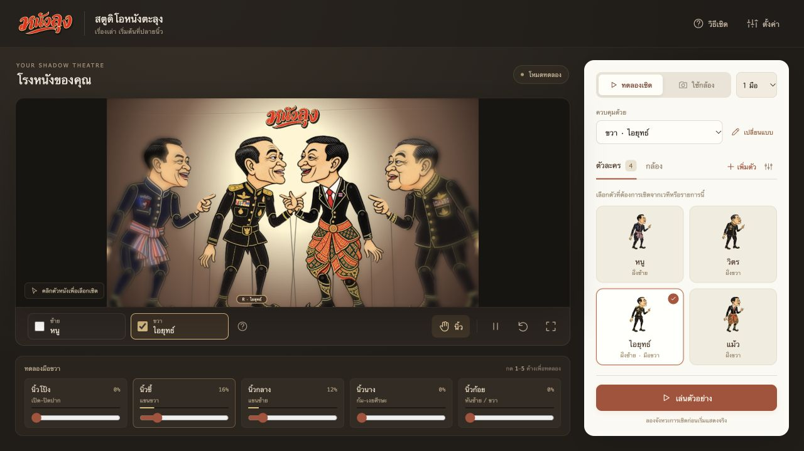
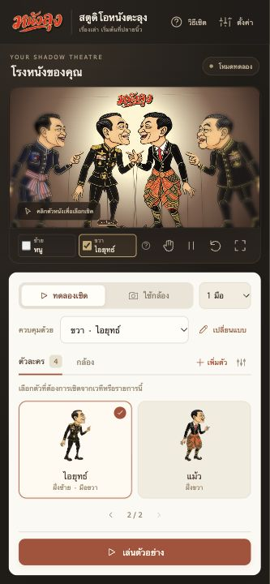

# ออกแบบสตูดิโอ NangLung ใหม่

1 พฤศจิกายน 2026

เป้าหมายคือให้ผู้แสดงมองเวทีเป็นหลัก เลือกตัวหนังที่ต้องการเชิดได้ทันที และจัดตัวละครได้ก่อนเปิดกล้อง การวิเคราะห์นี้มาจากการตรวจหน้าเดิมและทดสอบขั้นตอนในเบราว์เซอร์ ยังไม่ใช่ผลวิจัยกับผู้ใช้งานจริง

## ปัญหาที่พบและการตัดสินใจ

| สิ่งที่พบในหน้าเดิม | การออกแบบใหม่ |
| --- | --- |
| คลังแบบตัวละครกับตัวที่อยู่บนเวทีอยู่คนละบริบท ทำให้สับสนระหว่างเพิ่มกับเปลี่ยน | แยกปุ่ม **เพิ่มตัว** กับ **เปลี่ยนแบบ** เปิดคลังภาพเดียวกันด้วยหัวข้อและพฤติกรรมเฉพาะงาน |
| ต้องเปิดหน้าต่างจัดตัวละครจึงเห็นรายการบนเวที | แสดงรายการตัวที่อยู่บนเวทีในแผงข้าง เลือกได้จากภาพ พร้อมชื่อ ฝั่ง มือที่ควบคุม และสถานะเลือก |
| ส่วนควบคุมหลายโหมดทำให้หน้าจอแน่น | ใช้การเชิดผ่านกล้องอย่างเดียว แยกแผง **ตัวละคร / กล้อง** และเปิดกล้องเมื่อผู้ใช้สั่ง |
| เครื่องมือห้านิ้วใช้พื้นที่มากบนจอเล็ก | แสดงสัญญาณนิ้วจากกล้องอย่างเดียว ยุบไว้ในปุ่ม **นิ้ว** บนมือถือ เปิดเป็นแผงเหนือเวที ไม่ดันหน้าจอให้เลื่อน |
| ปุ่มและข้อมูลสำคัญมีน้ำหนักใกล้กัน | จัดลำดับ เวที → ตัวที่เลือก → แหล่งควบคุม → รายการตัวละคร → ปุ่มเริ่ม โดยย้ายค่าละเอียดไว้ในตั้งค่า |

## ภาษาภาพ

ใช้พื้นถ่าน `#211d19` ให้ฉากแสงตะเกียงเด่น แผงควบคุมสีครีม `#fcf9f2` ช่วยแยกพื้นที่ทำงาน สีชาด `#ad4f36` ใช้กับการเริ่มเชิดและตัวที่เลือก สีทองใช้กับสถานะบนเวที ใช้โลโก้ PNG เดิมของระบบและภาพตัวละครที่ผู้ใช้เลือก

จัดระยะห่าง มุมโค้ง ปุ่ม ไอคอน หน้าต่าง และสถานะ focus ให้สอดคล้องกัน คงคำไทยที่ใช้กับการแสดง เช่น เชิด ตัวหนัง ฝั่ง และปรับเทียบ

## ขั้นตอนหลัก

แถบใต้เวทีใช้ checkbox **ซ้าย / ขวา** พร้อมชื่อตัวละครที่ผูกกับมือนั้น เลือกหนึ่งข้างเพื่อเชิดหนึ่งตัว เลือกสองข้างเพื่อเชิดพร้อมกัน เอาออกหนึ่งข้างจะคงท่าตัวนั้น อีกข้างยังเชิดต่อได้ เอาออกทั้งหมดจะพักทั้งเวที การเลือกข้างที่ยังไม่ได้ผูกตัวละครจะใช้ตัวที่ว่าง โดยไม่แย่งตัวที่อีกมือกำลังเชิดอยู่

checkbox **ซ้าย / ขวาบนการ์ดตัวละคร** ใช้เลือกฝั่งแสดงบนเวทีของตัวนั้น เลือกหนึ่งฝั่งเสมอ แยกจาก checkbox เลือกมือใต้เวที การเลือกฝั่งไม่เปลี่ยนมือที่ผูกไว้ นิ้วก้อยสั่งหันที่ 60% โดยตัวหนังหมุนผ่านสันอย่างต่อเนื่องประมาณครึ่งวินาที ดู [ลำดับภาพการหมุน](puppet-turn-sequence.png)

1. **เตรียมตัวหนัง:** เพิ่มตัว → เลือกฝั่ง → เลือกภาพ ระบบเลือกตัวใหม่ให้พร้อมเชิดทันที
2. **เลือกควบคุม:** เลือกมือซ้ายหรือขวา → คลิกตัวบนเวทีหรือรายการ ปุ่มเปลี่ยนแบบทำงานกับตัวที่เลือกเท่านั้น
3. **เลือกมือ:** เช็กซ้าย/ขวาใต้เวที เลือกเชิดหนึ่งหรือสองตัวพร้อมกัน ปุ่มพัก รีเซ็ต และเต็มจออยู่ข้างกัน
4. **ใช้มือจริง:** เลือกใช้กล้อง → เปิดกล้อง → ปรับเทียบมือ ปุ่มปรับเทียบยังใช้ไม่ได้จนกว่ากล้องพร้อม
5. **จัดฉาก:** เปิดจัดตัวละครเพื่อย้ายฝั่งหรือนำออก รองรับ 12 ตัวรวมแบบซ้ำ ตัวที่ไม่ได้ควบคุมคงท่าเดิม

โหมดสองมือคงหลักหนึ่งมือต่อหนึ่งตัวละคร เลือกตัวที่อีกมือควบคุมอยู่จะโฟกัสมือนั้น ไม่ผูกสองมือกับตัวเดียว โปรไฟล์ปรับเทียบและข้อมูลเวทีใช้รูปแบบเดิม

## จอเล็กและการเข้าถึง

- คอมพิวเตอร์ใช้เวทีและแผงข้าง มือถือแนวตั้งเรียงเวทีเหนือแผงควบคุม ส่วนแนวนอนใช้สองคอลัมน์
- รายการด้านข้างแสดงตัวที่อยู่บนเวทีครบทั้งหมด สูงสุด 12 ตัว โดยไม่แบ่งหน้า จัดกริดและขนาดการ์ดตามจำนวนตัวละคร บนพื้นที่เตี้ยมากใช้ปุ่มชื่อแทนภาพเพื่อให้เลือกได้ครบโดยไม่ต้องเลื่อน
- แถบสัญญาณนิ้วปิดเป็นค่าเริ่มต้นทั้งคอมและมือถือ ผู้ใช้กดปุ่ม **นิ้ว** เพื่อเปิด/ปิดเอง การเปลี่ยนขนาดจอไม่เปิดแถบขึ้นอัตโนมัติ
- ปุ่มไอคอนมีชื่อสำหรับ screen reader และคำอธิบาย แท็บรองรับลูกศร/Home/End หน้าต่างใช้ native dialog เพื่อจัด focus และปิดด้วย Escape
- เวทีรองรับลูกศรซ้าย/ขวาเพื่อเลือกตัว ปุ่มลัด Space, R และ F ไม่ทำงานขณะพิมพ์หรือเปิดหน้าต่าง ส่วนปุ่มลัดทดลองนิ้ว 1–5 ถูกนำออกแล้ว

## ผลตรวจรอบนี้

- Vitest เดิม 85 กรณีผ่าน และ production build ใต้ `/nanglung/` ผ่าน
- ทดลองผ่าน UI: เพิ่มจากคลัง เปลี่ยนแบบโดยจำนวนไม่เพิ่ม สลับตัว ผูกมือซ้าย/ขวา เพิ่มครบ 12 ตัว ปุ่มเพิ่มหยุดที่ขีดจำกัด แบ่งหน้า ย้ายฝั่ง นำออก ทดลองนิ้ว พัก/เล่นต่อ และเข้า/ออกเต็มจอ
- วัด document, แผงข้าง และรายการตัวละครที่ 320×480, 375×812, 568×320, 844×390 และ 1366×768 ไม่พบ overflow แนวตั้งหรือแนวนอน
- ตรวจคลังภาพทุกขนาด และหน้าจัดตัวละคร คู่มือ ข้อมูลตัวละคร ตั้งค่าทั้งสามแท็บ แผงกล้อง และแผงสัญญาณนิ้วบนจอเล็กสุด โหมดทดลองและค่าตำแหน่งทดลองถูกนำออกแล้ว
- ตรวจหน้าปรับเทียบสี่ท่าพร้อมข้อความผิดพลาดผ่าน layout fixture ที่ 320×480 และ 568×320 ไม่พบ overflow โดยไม่ได้เปิดกล้องหรือจำลองว่าปรับเทียบสำเร็จ
- ไม่พบ console error/warning ระหว่างตรวจหน้าใหม่ การเชิดจริงผ่านเว็บแคมและความคล่องของผู้แสดงยังต้องประเมินบนเครื่องแสดงจริง

ขั้นต่อไปของการวิจัย UX ควรให้ผู้แสดงทดลองเพิ่มสามตัว เปลี่ยนตัวที่เชิด และเริ่มโหมดสองมือ แล้วเก็บเวลาทำงาน จุดที่กดผิด และความเข้าใจเรื่องฝั่งเวทีกับข้างของมือ
