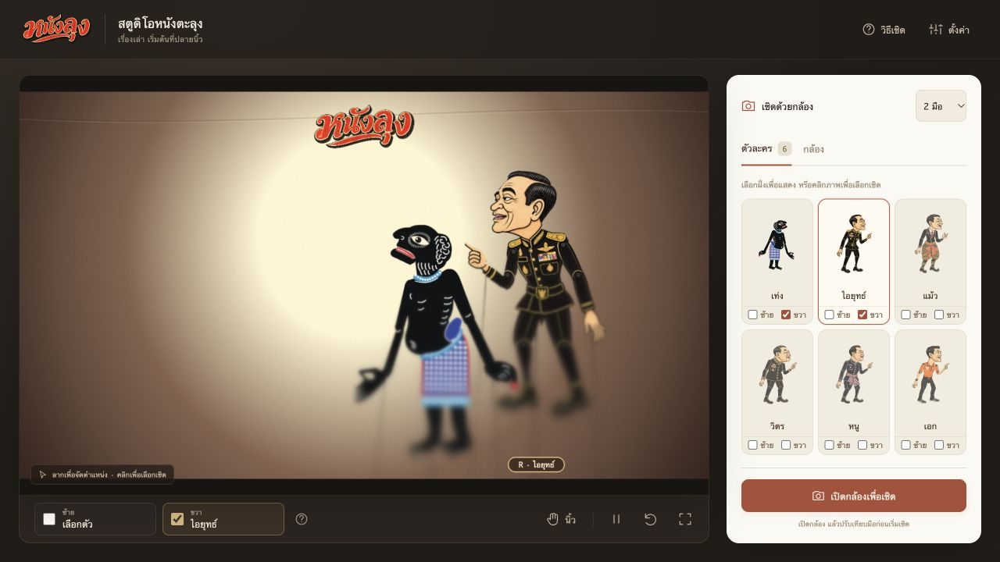
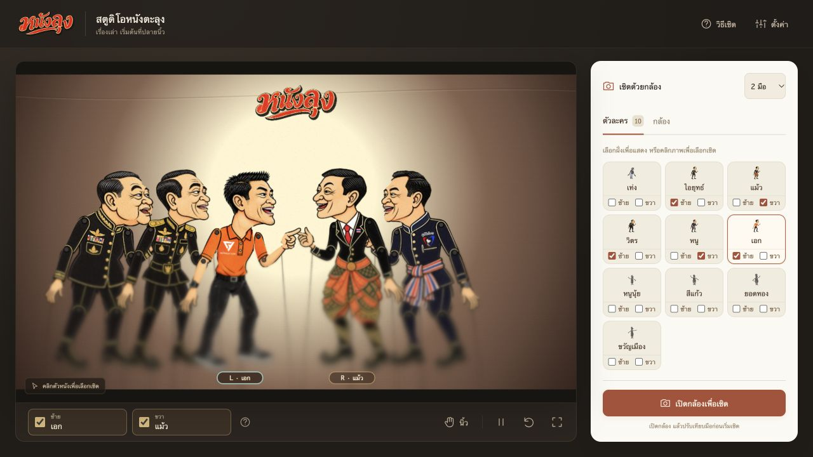
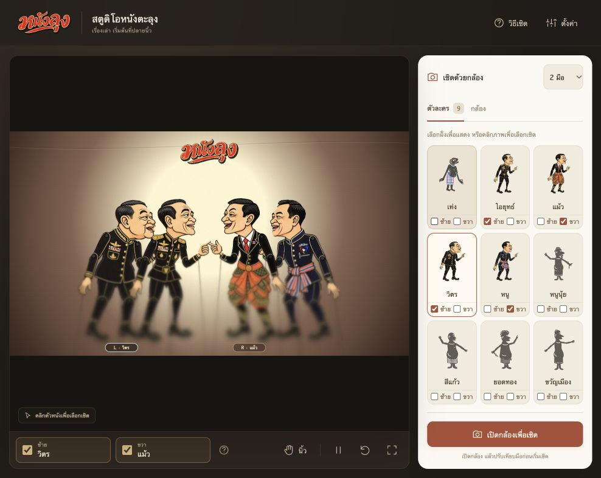
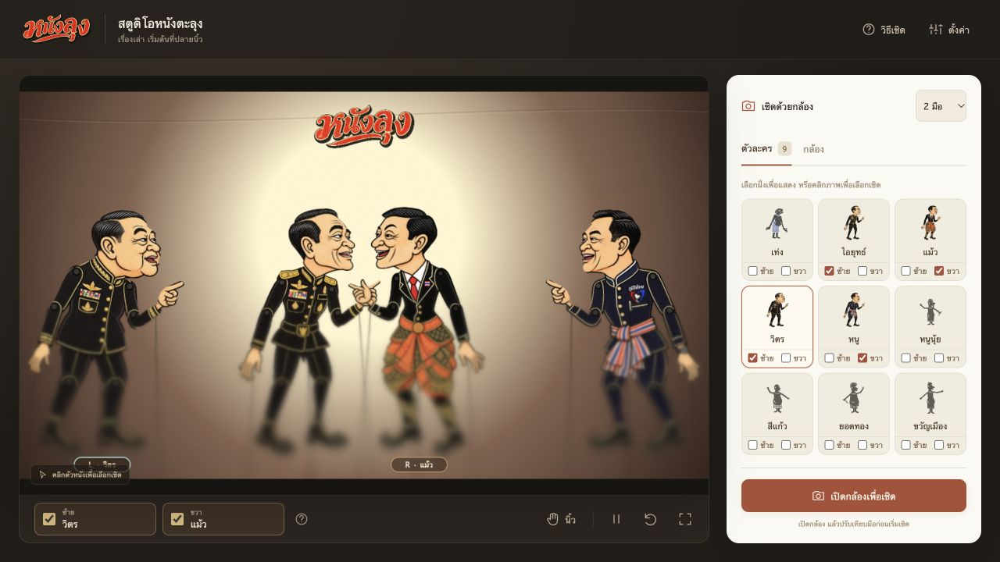
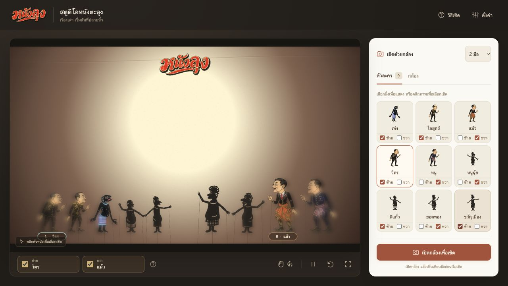

# ผลตรวจต้นแบบ NangLung Studio

## ลากจัดตำแหน่งและผูกมือตามฝั่ง — 1 พฤศจิกายน 2026

- ลากตัวละครบน Canvas ด้วย Pointer Events เพื่อวางตำแหน่งและย้ายข้ามกลางเวที มีเส้นแบ่งฝั่งระหว่างลาก แสดงตัวที่เลือกด้านหน้า และบันทึกตำแหน่งเมื่อปล่อย ยกเลิกด้วย Esc, pointercancel หรือเสีย pointer capture ได้ โดยคืนตำแหน่งและการผูกมือก่อนลาก
- ฝั่งซ้ายใช้มือซ้ายเท่านั้น ฝั่งขวาใช้มือขวาเท่านั้น รวมการคลิก การย้ายด้วย checkbox และโหมดมือเดียว การย้ายตัวที่กำลังเชิดจะย้ายการผูกมือไปฝั่งใหม่ การเคลื่อนจากกล้องถูกจำกัดภายในครึ่งเวทีนั้น
- อ่านข้อมูลเก่าแล้วแก้การผูกมือข้ามฝั่ง รักษาการผูกที่ตรงฝั่งอยู่แล้ว ท่า ขนาด 1.02 และโปรไฟล์เดิมไว้ ตัวที่ลากไม่รับท่าจากกล้องระหว่างจัดตำแหน่ง และปรับจุดอ้างอิงเมื่อปล่อยเพื่อให้เชิดต่อได้
- Vitest 110 กรณีผ่าน รวมตำแหน่งหลัง reload ขนาดคงที่เมื่อเพิ่มตัว การข้ามฝั่ง การแก้ข้อมูลเก่า และขอบเขตการเคลื่อนไหว `tests/stage-drag.html` ผ่านการลากข้ามฝั่ง ยกเลิกด้วย Esc และ pointercancel รวม pointer แบบสัมผัสจำลอง
- ตรวจการลากผ่านเบราว์เซอร์ด้วยเมาส์: ลากซ้าย→ขวา ลากภายในฝั่ง โหลดใหม่แล้วตำแหน่งคงเดิม ลากกลับซ้าย และเลือกข้ามฝั่งในโหมดมือเดียว มือที่ไม่มีตัวฝั่งเดียวกันจะเปิดไม่ได้ ไม่มี console error/warning การตรวจนี้ไม่ได้เปิดกล้องจริงหรือทดสอบอุปกรณ์สัมผัสจริง
- Renderer fixture ผ่าน 4 กรณี ท่าหันตัวผ่าน 5 กรณี และหัวชัดถึงขาเบลอผ่าน 5 กรณีหลังปรับพิกัดใหม่

## นำหนูนุ้ย สีแก้ว ยอดทอง และขวัญเมืองออก — 1 พฤศจิกายน 2026

- เหลือหกแบบ: เท่ง ไอยุทธ์ แม้ว วิตร หนู และเอก ลบคำจำกัดความรูปหนัง ท่าตัวอย่าง และ SVG ดาวน์โหลดของทั้งสี่แบบออกจากชุดใช้งาน
- อ่านฉากเดิมแล้วตัดสมาชิกทั้งสี่แบบและการผูกมือออก บันทึกฉากที่ปรับแล้วกลับลงเบราว์เซอร์ ถ้าเหลือแต่ตัวที่ถูกนำออกให้เวทีว่าง คงท่าและการผูกมือของตัวที่เหลือ รวมทั้งโปรไฟล์ปรับเทียบและหน้าที่นิ้ว
- ชุดทดสอบ 105 กรณีผ่าน รวมกรณีลบหมด ลบบางส่วน คงตัวที่เหลือโดยไม่เลือกตัวใหม่ให้เอง และกู้คืนค่าเก่าโดยคงการปรับเทียบไว้
- `tests/retired-cast.html` ตรวจบน origin ทดสอบแยกผ่านทั้งฉากผสมและฉากที่มีแต่ตัวที่นำออก ยืนยันข้อมูลที่เขียนกลับจริง การผูกมือ ท่าของตัวที่เหลือ และโปรไฟล์ปรับเทียบคงอยู่ ตรวจรายการจริงเหลือหกแบบ ไม่มี console error/warning และ build ผ่าน

## เพิ่มเอก — ธนาธร จึงรุ่งเรืองกิจ — 1 พฤศจิกายน 2026

- เพิ่มแบบที่หกในชุดหลักและรวมเป็นสิบแบบในรายการ ใช้ PNG RGB ต้นฉบับ 1024×1536 ตามภาพผู้ใช้ เก็บ bytes เดิม แยกหัว กราม แขนสองข้าง และมือ พร้อมไฟล์ SVG ฝังภาพดาวน์โหลดได้
- หน้ากากเวกเตอร์จากพื้นขาวที่เชื่อมถึงขอบภาพทำให้พื้นและช่องระหว่างขาโปร่งใส แต่เก็บสีขาวในโลโก้และพื้นรองเท้าไว้ ตรวจภาพท่าพัก/ครึ่งท่า/สุดท่า ไม่มีรอยแขนเดิมบนลำตัว
- Vitest 114 กรณีและ build ใต้ `/nanglung/` ผ่าน รวม checksum ต้นฉบับ การตรงตำแหน่งทั้งเก้าชิ้น การบันทึกตัวเลือก และ SVG อ้างอิงครบ `tests/thanathorn.html` ผ่านสามกรณีตรวจพิกเซล/ความโปร่งใส/ท่าขยับ
- ตรวจเลือกเอกให้มือซ้าย ย้ายฝั่ง และคืนฉากทดสอบเดิมได้ การเลือกอีกมือและโปรไฟล์เดิมคงอยู่ รายการสิบแบบที่ 320×480, 375×812, 568×320, 844×390, 1366×768 ไม่มี overflow หรือชื่อ/checkbox ถูกตัด รวม fixture ตัวซ้ำเดิม 21 ใบด้วย
- ตรวจไฟล์ดาวน์โหลด SVG และภาพรวมชุดหลักหกตัว ไม่มี console error/warning การตรวจท่าใช้ภาพจำลองบน renderer ไม่ได้เปิดกล้องจริง

## ขนาดคงที่และตัวฝั่งเดียวกันชิดขึ้น — 1 พฤศจิกายน 2026

- ล็อก scale 1.02 เท่าตัวกลางในภาพอ้างอิงสำหรับทุกจำนวน ยกเลิกการย่อตามจำนวนตัวละคร โดยยังรักษาเอฟเฟกต์หัวชัด ไล่เบลอและขยายเล็กน้อยถึงขา
- ฝั่งละสองตัวลดระยะจาก 384 เป็นประมาณ 154 หน่วยในฉาก 1280 หน่วย กลุ่มใหญ่ใช้ช่วงกว้างไม่เกิน 24% ของเวที ไม่กระจายถึงริมเหมือนเดิม
- ชุดทดสอบ 109 กรณีผ่าน ครอบคลุมขนาดคงเดิมเมื่อเพิ่มจนเต็มและย้ายฝั่ง ตรวจ UI เพิ่มจากสี่เป็นห้าตัวและคืนฉากเดิม การผูกมือคงเดิม ไม่มี console error/warning

## หัวชัด ไล่เบลอและขยายลงถึงขา — 1 พฤศจิกายน 2026

- ย้ายเอฟเฟกต์ความชัดมาที่ตัวละครแต่ละตัว ยกเลิกหน้ากากวงกลมที่ทำให้หัวริมเวทีเบลอ หัวคงภาพเดิมแล้วค่อยผสมความเบลอ 0–9 px ในพิกัดตัวหนังลงถึงขา พร้อมขยายช่วงล่าง 0–7% ต่อเนื่องและรักษาแนวเท้า
- พื้นที่คลิกคำนวณย้อนการขยายตามแนวตั้ง รวมการหมุน ความเอียง และท่ากลับด้านผ่านสัน ช่องโปร่งยังโปร่งใส และไม่มีรอยต่อความทึบระหว่างระดับเบลอ
- ชุดทดสอบ 108 กรณีผ่าน; `tests/puppet-depth.html` ผ่าน 5 กรณี ตรวจพิกเซลหัวไม่เปลี่ยน contrast ลดจากหัวถึงขา ความกว้างเพิ่มเล็กน้อย ช่องโปร่งและความทึบคงอยู่; renderer fixture ผ่าน 4 กรณี และ turn fixture ผ่าน 5 กรณี
- ตรวจภาพจริงสี่ตัว หัวทุกตัวคมชัดรวมริมเวที และขาฟุ้งขึ้นตามลำดับ แคชเฉพาะภาพท่าที่เปลี่ยน การย้ายตำแหน่งและกลับด้านไม่สร้างชั้นเบลอใหม่ การตรวจนี้ไม่ใช่การทดสอบกล้องจริง

## ลดขนาดตัวละครและเว้นระยะตามจำนวน — 1 พฤศจิกายน 2026

- ลด scale จาก 1.46 เป็น 1.12 สำหรับฝั่งละตัว และไม่เกิน 1.02 สำหรับหลายตัว ย่อต่อเนื่องตามช่องว่างเมื่อมีสามตัวขึ้นไปในฝั่งเดียวกัน กระจายจุดด้านในและลดการเอียงเพื่อให้ทับกันน้อยลง
- ยกแนวเท้าเป็น 680 ภายในฉากสูง 720 โดยไม่เปลี่ยนท่าที่บันทึกไว้หรือการผูกมือ ตัวละครยังเลื่อนทับกันได้หากผู้เชิดขยับมือเข้าหากัน
- ตรวจฉากจริง 4 และ 9 ตัว มือซ้าย/ขวาคงตัวเดิม คืนฉากหลังทดสอบ ไม่มี console error/warning ชุดทดสอบ 105 กรณีผ่าน และ production build ผ่าน

## รายการครบทุกแบบและเลือกมือใต้เวทีจุดเดียว — 1 พฤศจิกายน 2026

- แสดงคลัง 9 แบบทันทีในรายการด้านข้าง ลบปุ่มเพิ่มตัว เปลี่ยนแบบ หน้าต่างคลัง/จัดตัวละคร และเมนูควบคุมด้วยด้านข้าง
- คลิกภาพเพื่อแสดงและเลือกเชิดได้โดยตรง checkbox บนการ์ดใช้แสดง ย้ายฝั่ง หรือซ่อน ตัวที่ยังไม่แสดงยังเห็นภาพในรายการครบ และคงตัวซ้ำที่ผู้ใช้บันทึกไว้
- ใต้เวทีใช้ checkbox เปิด/พักมือ และกดชื่อมือเพื่อเลือกมือที่จะเชิด การสลับโฟกัสในโหมดสองมือไม่หยุดอีกตัว แถบนิ้วยังคงปิดเป็นค่าเริ่มต้น
- ชุดทดสอบ 105 กรณีผ่าน เพิ่มการตรวจรายการครบทุกแบบโดยไม่เปลี่ยนฉากเดิม เลือกใช้ซ้ำไม่สร้างตัวซ้ำ ซ่อนจนเวทีว่างและกู้คืนหลัง reload รวมถึงเก็บตัวซ้ำจากรุ่นเดิม
- ตรวจ UI แสดง/ซ่อน ย้ายฝั่ง และเลือกตัวใหม่ให้มือขวาโดยมือซ้ายยังคงตัวเดิม การซ่อนไม่เลือกตัวอื่นให้เองแม้ reload ไม่มี console error/warning และไม่พบปุ่มหรือเมนูที่นำออกเหลืออยู่
- ตรวจรายการปกติ 9 ใบ และ legacy fixture 20 ใบ (เก้าแบบรวมตัวซ้ำบนเวทีเดิม) ที่ 320×480, 375×812, 568×320, 844×390, 1366×768 ไม่พบชื่อหรือช่องเช็กถูกตัด ไม่มี scrollbar

## Checkbox เลือกฝั่งต่อการ์ด และท่าหันตัวที่ 60% — 1 พฤศจิกายน 2026

- แต่ละการ์ดมี checkbox ซ้าย/ขวาเพื่อย้ายฝั่งแสดง เลือกหนึ่งฝั่งเสมอ ผูกกับตำแหน่งเวทีแยกจากมือที่เชิด ใช้คำสั่งย้ายร่วมกับหน้าจัดตัวละคร และบันทึกหลัง reload ได้
- นิ้วก้อยใช้ threshold 60% แบบรวมขอบ ใช้ค่าสัญญาณที่ normalize แล้วก่อน smoothing สำหรับ trigger จึงสั่งได้เมื่อค้างที่ 60% จริง ยังคงงอค้าง 350 ms ปล่อย 200 ms และหนึ่งคำสั่งต่อการค้าง
- วาดการหมุนแผ่นหนัง 520 ms ผ่านการย่อความกว้างจนเห็นสันแล้วเปิดอีกหน้า มีการเอียงเล็กน้อย หยุด/ต่อ motion เมื่อพัก และคำนวณพื้นที่คลิกตามขนาดระหว่างหมุน
- ชุดทดสอบ 100 กรณีผ่าน รวม threshold, ค้างไม่สั่งซ้ำ, การหมุนต่อเนื่อง, กลับทิศกลางท่า, พัก/เล่นต่อ, พื้นที่คลิกขณะหมุน และย้ายฝั่งโดยไม่เปลี่ยนการผูกมือ
- `tests/turn-motion.html` ใช้ renderer จริง ตรวจการวาดต่อแม้ facing คงเดิม พื้นที่คลิกระหว่างหมุน สันไม่กินพื้นที่คลิกเดิม และพัก/ต่อภาพผ่านทั้งหมด ตรวจ renderer เดิมเพิ่มเติมด้วย `tests/cast-renderer.html`
- ตรวจรายการ 12 ตัว มี checkbox 24 ช่องและเลือกอยู่ 12 ช่อง ที่ 320×480, 375×812, 568×320, 844×390, 1366×768 ไม่มีชื่อหรือช่องเช็กถูกตัด และไม่มี scrollbar การเชิดนิ้วก้อยกับกล้องจริงยังต้องตรวจบนอุปกรณ์ผู้แสดง

## ลบโหมดทดลองเชิด — 1 พฤศจิกายน 2026

- เหลือการเชิดผ่านกล้องอย่างเดียว ลบปุ่มสลับโหมด เล่นตัวอย่าง แถบเลื่อนนิ้ว/ตำแหน่ง แท็บทดลองในตั้งค่า และปุ่มลัด 1–5 ออกจากแอปจริง แผงนิ้วใช้แสดงสัญญาณจากกล้องเท่านั้น
- ถอดการป้อนท่าจำลองออกจากวงรอบวาด ตัวละครคงท่าที่บันทึกไว้เมื่อกล้องปิด โดยคงการเลือกตัวละคร checkbox ซ้าย/ขวา พัก รีเซ็ต และปรับเทียบมือ
- ตรวจ UI ไม่มีตัวควบคุมทดลองแล้ว เปิดตั้งค่าได้สามแท็บ เลือกตัวและแผงกล้องได้ ปุ่มปรับเทียบยังปิดไว้จนกว่ากล้องพร้อม ไม่พบ console error/warning
- ตรวจแผงตัวละคร/กล้องที่ 320×480, 375×812, 568×320, 844×390, 1366×768 และตั้งค่าทั้งสามแท็บบนสองจอเล็ก ไม่พบ overflow
- ชุดทดสอบ 91 กรณีผ่าน และ vision fixture ใช้ worker/WASM/โมเดลจริงกับภาพตัวอย่าง 6 เฟรมผ่าน พบ Left/Right ข้างละ 21 จุด ส่งสัญญาณนิ้วห้าช่องให้ตัวควบคุมแต่ละมือได้ การตรวจนี้ไม่ได้เปิดเว็บแคมจริง

## ตัดแถบหัวข้อเหนือเวที — 1 พฤศจิกายน 2026

- ลบหัวข้อ YOUR SHADOW THEATRE / โรงหนังของคุณ พร้อมป้ายสถานะด้านขวา และโค้ดอัปเดตป้ายออก พื้นที่เวทีใช้ความสูงที่ว่างขึ้น
- ตรวจหน้าเดิมทั้งห้าขนาด ไม่มี scrollbar ปุ่มพัก/เชิดต่อและสลับโหมดทำงาน ไม่พบ console error/warning ชุดทดสอบ 91 กรณีและ build ใต้ `/nanglung/` ผ่าน

## รายการด้านข้างแสดงครบทุกตัว — 1 พฤศจิกายน 2026

- ยกเลิกการแบ่งหน้ารายการด้านข้าง แสดงตัวละครบนเวทีทั้งหมดพร้อมกัน สูงสุด 12 ตัว โดยไม่เพิ่มหรือเปลี่ยนตัวละครในฉากที่ผู้ใช้จัดไว้
- ตรวจเพิ่มครบ 12 ตัว ครบทั้ง 9 แบบรวมตัวซ้ำ ยืนยันว่ามีการ์ด 12 ใบและทุกใบอยู่ในกรอบรายการที่ 320×480, 375×812, 568×320, 844×390 และ 1366×768 ไม่มี overflow ทั้ง document และแผงควบคุม
- ทดสอบเลือกตัวที่ 9 และ 12 ได้โดยตรง พร้อมตรวจการ์ดห้าตัวหลัก บนจอเตี้ยมากการ์ดเปลี่ยนเป็นปุ่มชื่อเพื่อแสดงได้ครบ
- ชุดทดสอบเดิม 91 กรณีและ production build ใต้ `/nanglung/` ผ่าน

## Checkbox ซ้าย–ขวาใต้เวที — 1 พฤศจิกายน 2026

- เปลี่ยนข้อความตัวที่กำลังควบคุมเป็นช่องเช็กซ้ายและขวาพร้อมชื่อตัวละคร เลือกได้หนึ่งหรือสองข้าง และพักทั้งหมดเมื่อเอาเครื่องหมายออกครบ
- เพิ่มทดสอบการเปิดสองมือ พักมือเดียว พักทั้งหมด เชิดต่อ ผูกตัวที่ยังว่าง และป้องกันสองมือเชิดตัวเดียว รวมชุดทดสอบ 91 กรณีผ่าน
- ตรวจ UI จริงว่าช่องเช็กตรงกับเมนูจำนวนมือ การพัก/เชิดต่อ และชื่อหลังสลับตัวละคร พร้อมตรวจแถบเครื่องมือที่ 320×480, 375×812, 568×320, 844×390, 1366×768 ไม่มี overflow

## ออกแบบ UX/UI ใหม่ — 1 พฤศจิกายน 2026

- เวทีและแผงควบคุมออกแบบใหม่โทนถ่าน–ครีม–สีชาด มีรายการตัวละครบนเวที แยกเพิ่มตัว/เปลี่ยนแบบ แผงตัวละคร/กล้อง และแถบนิ้วยุบได้ ดู [การวิเคราะห์และขั้นตอนใหม่](UX_REDESIGN.md)
- ทดสอบเดิม 85 กรณีผ่าน และ build ด้วย `--base /nanglung/` ผ่าน
- ตรวจ UI จริงทั้งเพิ่มจากคลัง เปลี่ยนแบบ สลับตัวจากการ์ดและคลิก Canvas ผูกสองมือ เพิ่มครบ 12 ตัว แบ่งหน้า ย้ายฝั่ง นำออก ทดลองนิ้ว พัก/เล่นต่อ และเต็มจอ
- หน้าเวทีและคลังภาพพอดีที่ 320×480, 375×812, 568×320, 844×390, 1366×768 ตรวจหน้าตั้งค่าทั้งสี่แท็บ คู่มือ ข้อมูลตัวละคร จัดตัวละคร กล้อง และแถบนิ้วบนจอเล็ก พร้อมแก้ overflow ที่พบแล้ว
- หน้าปรับเทียบพร้อมข้อความผิดพลาดตรวจผ่าน fixture ที่ 320×480 และ 568×320 โดยไม่ได้ขอเปิดกล้อง การรับมือจริงยังต้องทดสอบบนเครื่องแสดงจริง
- ระหว่างตรวจหน้าใหม่ไม่พบ console error/warning บันทึกภาพเดสก์ท็อปและมือถือไว้ในเอกสาร UX

## เปลี่ยนสี่ตัวเป็นภาพ PNG ใหม่ของผู้ใช้ — 31 ตุลาคม 2026

- ใช้ PNG ต้นฉบับทั้งสี่โดยตรง จับคู่เครื่องแบบดำกับไอยุทธ์ สูทและผ้านุ่งแดงทองกับแม้ว รูปป้อมกับวิตร ชุดครามคาดธงไทยกับหนู คง ID โปรไฟล์ และการจัดเวทีเดิม
- Vitest ผ่าน 85 กรณี รวม checksum ของทั้งสี่ไฟล์ และตรวจเมทริกซ์ภาพทั้งเก้าชิ้นต่อตัวให้ตรงกันที่ท่าพัก การหมุนข้อต่อใช้ข้อมูลเดียวกันใน Canvas/SVG
- SVG ดาวน์โหลดฝัง PNG เพียงครั้งเดียวต่อไฟล์ และอ้างภาพนั้นจากแต่ละชิ้น พรีวิวบนหน้าจอใช้ inline SVG โหลด PNG ร่วมกับเวที
- ตรวจท่า 0%, 50% กลับด้าน, 100% และตัวละครบนฉากผ้า รายละเอียดใน [USER_CHARACTER_ART.md](USER_CHARACTER_ART.md)

---

## ฉากผ้าและคลิกเลือกตัวละครหลายตัว — 31 ตุลาคม 2026

- ทดสอบ 77 กรณีผ่าน พร้อม build สำหรับ `/nanglung/` ตรวจ renderer จริง: hit test ตัวหมุน/กลับด้าน การไม่เลือกเมื่อกดขอบดำ และการล้างพื้นที่กดของตัวที่ลบ ผ่านทั้งหมด
- ตรวจเพิ่มถึง 12 ตัว (ข้างละ 6) และ reload ผ่าน UI รายการและตัวที่ผูกมือยังครบ ปุ่มเพิ่มหยุดที่ขีดจำกัด ลบตัวที่ผูกมือแล้วเลือกตัวทดแทนได้ ท่าและการหันแยกเป็นรายตัว
- คลิกเท่งบน Canvas เพื่อเปลี่ยนการควบคุมได้ ตั้งปากเท่งแล้วสลับไปแม้ว เท่งคงท่าเดิม ตรวจการย้ายฝั่งและกลับทิศเมื่อย้ายแล้ว
- หน้าและ dialog จัดตัวละครพอดี 320×480, 375×812, 568×320, 844×390, 1366×768: document เท่ากับ viewport, dialog ไม่มี overflow และปุ่มหลักอยู่ในจอ
- โลโก้สร้างใหม่เป็น PNG RGBA 1774×887 มี alpha 0–255 ไม่มีพื้นทึบครอบฉาก ดูพรอมป์ต์ ไฟล์ และรายละเอียดใน [SCENE_AND_CAST.md](SCENE_AND_CAST.md)

---

## ชุดหลักห้าตัวแบบหนังฉลุ — 31 ตุลาคม 2026

- ลำดับหลัก: เท่ง ไอยุทธ์ แม้ว วิตร หนู อีกสี่ตัวเลือกจาก “ตัวหนังอื่น” รวม 9 ตัว เก็บ ID ของไอยุทธ์/แม้วและโปรไฟล์ปรับเทียบเดิม
- Vitest ผ่าน 67 กรณี รวม SVG ที่ใช้ได้เอง จุดหมุนแขน–กราม ท่าตัวอย่าง ช่องฉลุ และการบันทึกตัวละครใหม่แยกมือ Build ที่ `/nanglung/` ผ่าน
- ตรวจภาพทุกตัวที่ท่า 0%, 50% กลับด้าน และ 100% ใน [character-pose-matrix.png](character-pose-matrix.png) และภาพรวมหลักใน [characters-sheet.png](characters-sheet.png)
- ตรวจคู่ วิตร–หนู บน Canvas พร้อมเล่นตัวอย่าง และสลับกลับหนูนุ้ยจากเมนูคลังได้
- ตรวจ 320×480, 375×812, 568×320, 844×390, 1366×768: ขนาด document เท่ากับ viewport ไม่มี overflow ทั้งสองแนว ปุ่มตัวละคร เมนูคลัง ปุ่มกล้อง และปุ่มเล่นตัวอย่างอยู่ในจอ
- งานรอบนี้แก้รูปตัวละครและตัวเลือก UI ไม่ได้แก้โมเดลหรือตัวประมวลผลมือ ผลตรวจจากภาพก่อนหน้าไม่แทนการทดสอบมือจริงที่บังหรือไขว้กัน

รายละเอียดภาพอ้างอิงและขอบเขตการดัดแปลงอยู่ใน [SOUTHERN_CHARACTER_STYLE.md](SOUTHERN_CHARACTER_STYLE.md)

---

วันที่ 31 ตุลาคม 2026

## ตรวจแล้ว

- TypeScript และ production build ผ่าน
- Vitest 60 กรณีผ่าน: การปรับเทียบรายนิ้ว มุม การสลับทิศ การพัก มือหลุด/กลับเข้า ผลลัพธ์เก่า การเก็บค่า lifecycle กล้อง การไม่สะสมเฟรม โครงข้อต่อห้าตัว อุปกรณ์ SVG ท่าตัวอย่าง และการควบคุมสองมือแยกกัน
- โมเดล MediaPipe จริงพร้อม WASM ใน classic worker ตรวจพบมือซ้ายและขวา ข้างละ 21 จุด จากภาพตัวอย่างมาตรฐาน 6 เฟรมต่อเนื่อง
- รอบสุดท้ายบน GPU: เวลา inference เฉลี่ย 45 ms และเฉลี่ย 15 ms สำหรับห้าเฟรมหลังเฟรมแรก เป็นภาพตัวอย่าง 640×960 ไม่ใช่ความหน่วงกล้องจริงถึงจอ
- ตรวจ worker ทั้งการใช้ CPU ในรุ่นเริ่มต้น และการเลือก GPU ในรุ่นปัจจุบัน โดยใช้ไฟล์โมเดล/WASM จากเครื่อง
- ตรวจ UI จริง: ตัวอย่างการเคลื่อนไหว แถบเลื่อนนิ้ว การสลับหน้าที่อัตโนมัติ พัก/รีเซ็ตท่า เปลี่ยนสีเวที เปิดคู่มือ และเข้า/ออกเวทีเต็มจอ
- เปิดตรวจ production build ผ่าน `npm run preview` และทดสอบแขนทั้งสองที่ค่าสูงสุด 100% แล้ว
- เปลี่ยนการตั้งค่าแล้ว reload: ค่าได้รับการกู้คืน และคืนค่าเริ่มต้นได้
- ตรวจหน้าจอ 375px และ 1440px ไม่มี horizontal overflow
- ตรวจ console ของหน้าสตูดิโอและหน้า integration test ไม่พบ error/warning ในรอบที่ตรวจ
- `npm audit` ไม่พบช่องโหว่ในชุด dependencies ที่ติดตั้ง
- ตรวจ syntax ของไฟล์ `เปิดสตูดิโอ.command` ด้วย `bash -n`

## ชุดตัวละครห้าตัว

- ตรวจภาพเวกเตอร์และ Canvas ของเท่ง หนูนุ้ย สีแก้ว ยอดทอง ขวัญเมือง พร้อมเทียบเส้นรอบรูป ท่าพัก ปาก และแขน
- ตรวจ matrix ที่ค่า 0%, 50%, 100% รวมภาพกลับทิศ ไม่พบจุดหมุนหรือกรามหลุดจากชิ้นส่วนหลักในภาพที่ตรวจ
- ตรวจการเลือกทั้งห้าตัว มีสถานะเลือกเพียงตัวเดียวและมือที่เลือกไม่เปลี่ยน
- ทดสอบงอนิ้วก้อยจนหันซ้าย แล้วสลับตัวขณะค้างนิ้ว: ตัวใหม่ยังหันซ้ายและไม่หันซ้ำโดยไม่ปล่อยนิ้ว
- เปิดข้อมูลตัวละครและตรวจลิงก์แหล่งอ้างอิง/ไฟล์ SVG ตามตัวที่เลือก
- ตรวจอุปกรณ์เปิด–ปิดได้ และมีชิ้นส่วนเฉพาะของเท่ง หนูนุ้ย และยอดทอง
- ตรวจ XML ของ SVG ทั้งห้า ไฟล์อ่านได้และไม่มี id ซ้ำในไฟล์เดียว
- ตรวจหน้าใหม่ในกรอบ iframe กว้าง 375px จริง: document clientWidth/scrollWidth เท่ากับ 375 ไม่มี horizontal overflow (ผลตรวจรุ่นก่อนจัดหน้าแบบไม่เลื่อน)
- ตรวจหน้าเดสก์ท็อปกว้าง 1500px และบันทึกภาพตัวละคร/หน้าสตูดิโอประกอบ
- ตรวจ production build ครบห้าปุ่ม: ภาพย่อโหลดสำเร็จทั้งหมดและมีสถานะเลือกเพียงตัวเดียว ไม่พบ console error/warning ในรอบตรวจ
- ข้อมูลตัวละครและสถานะอุปกรณ์บันทึกแยกจากโปรไฟล์ปรับเทียบ การทดสอบ parseSettings ยืนยันการกู้คืนค่ามือ/หน้าที่นิ้วและโปรไฟล์เดิม

ดูรายละเอียดการสร้างและขอบเขตการดัดแปลงใน [CHARACTER_IMPLEMENTATION.md](CHARACTER_IMPLEMENTATION.md) ยังไม่ได้ให้ครูหนังตรวจแบบห้าตัว

## ปรับ UI ให้พอดีจอโดยไม่เลื่อน

- จัดหน้าแบบเต็ม viewport ด้วยพื้นที่เวทียืดหยุ่น แผงควบคุมด้านข้างบนจอแนวนอน และด้านล่างบนจอแนวตั้ง
- ตัดเมนูซ้าย หัวข้อโฆษณา ข้อความซ้ำ และตัวเลข FPS/inference ออกจากหน้าหลัก ย้ายตัวเลือกขั้นสูงเป็นกล่องสี่แท็บ
- วัด document clientWidth/scrollWidth และ clientHeight/scrollHeight เท่ากันที่ 320×480, 320×568, 375×812, 568×320, 844×390, 1280×720 และ 1366×768 ปุ่มหลักและแถบควบคุมอยู่ภายใน viewport
- ตรวจทั้งสี่แท็บที่ 320×480, 375×812, 568×320, 844×390 และ 1366×768 พร้อมปรับแถบตำแหน่งทดลองเป็นแถวแนวนอนบนจอเตี้ย
- ตรวจคู่มือและข้อมูลตัวละครที่ 320×480, 568×320 และ 844×390 เนื้อหาและปุ่มไม่ถูกตัด
- ตรวจกล่องปรับเทียบผ่าน layout fixture ที่สามขนาดเดียวกัน รวมข้อความสถานะและข้อผิดพลาด ปุ่มปิด เริ่มใหม่ และบันทึกอยู่ในกล่องครบ การตรวจนี้ไม่เรียกกล้องหรือยืนยันการปรับเทียบจริง
- ตรวจ production build: เปลี่ยนตัวละคร เล่นตัวอย่าง พัก/รีเซ็ต สลับแท็บด้วยลูกศร สลับหน้าที่นิ้ว เปลี่ยนสีเวที และเปิด/ปิดอุปกรณ์ได้ ค่าตั้งค่าได้รับการกู้คืนหลัง reload
- Production build และ Vitest 43 กรณีผ่านหลังปรับ UI ไม่พบ console error/warning ในรอบตรวจ

## โหมดสองมือ สองตัวละคร

- ตรวจตัวควบคุมแยกมือด้วย Vitest: ลำดับผลตรวจจับกลับด้านไม่สลับตัวละคร มือหนึ่งหลุดไม่หยุดอีกตัว นิ้วก้อย flip แยกกัน ผลเก่าไม่แทนที่ผลใหม่ การเก็บค่าปรับเทียบไม่ขยับตัวละคร และโหมดหนึ่งมือยังเลือกเฉพาะมือที่กำหนด
- ตรวจการย้ายค่ารุ่นเดิมและกู้คืนตัวละครแยกซ้าย/ขวา โดยคงโปรไฟล์และหน้าที่นิ้วเดิม
- `/tests/vision.html` ใช้ worker, WASM และโมเดลจริงบนภาพ MediaPipe 6 เฟรม: พบทั้ง Left/Right ข้างละ 21 จุด ตัวควบคุมทั้งสองอยู่สถานะ tracking และมีสัญญาณนิ้วข้างละ 5 ช่อง รอบนี้ใช้ GPU เฉลี่ย 44 ms และ 15 ms สำหรับห้าเฟรมหลังเฟรมแรก
- ตรวจในเบราว์เซอร์: สองตัวอยู่บนเวทีพร้อมกัน เลือกตัวละครแยกมือ ทดลองแถบนิ้วคนละชุด งอก้อยมือซ้ายพลิกเฉพาะตัวซ้าย และกู้คืนโหมด/ตัวละครหลัง reload ได้
- วัด UI โหมดสองมือที่ 320×480, 375×812, 568×320, 844×390 และ 1366×768: document ไม่มี overflow ทั้งสองแนว และปุ่มหลักอยู่ในจอ
- การตรวจจากภาพยืนยันเส้นทางผลโมเดลเข้าสู่ตัวควบคุมทั้งสอง ไม่แทนการเชิดสองมือจริงผ่านเว็บแคม ยังต้องทดสอบเมื่อมือบัง/ไขว้กัน และความลื่นบนเครื่องแสดงจริง

## เตรียม GitHub Pages

- ปรับเท่งตามภาพอ้างอิงผู้ใช้ และตรวจท่า 0%, 50% กลับด้าน, 100% ใน matrix เดียวกับตัวอื่น พร้อมตรวจบน Canvas โหมดสองตัวละคร สีตา สร้อย ปาก ผ้านุ่ง และปลายนิ้วอยู่ครบ
- เพิ่มกรณีทดสอบสีและส่วนตกแต่งที่ติดมือ/กราม ทดสอบล่าสุด 52 กรณีผ่าน และ build ที่ `/nanglung/` ผ่านสำหรับชื่อ repository ที่ผู้ใช้เลือก

- เพิ่ม `.github/workflows/pages.yml`: ติดตั้งจาก lockfile รัน tests อ่าน base path จาก Pages แล้ว build/upload/deploy โดยแยกสิทธิ์ build และ deploy
- ตรวจ commit SHA ของ actions ทั้งห้ากับ GitHub แล้ว และ parse YAML ผ่าน ต่อมาผู้ใช้เลือก repository `kimookpong/nanglung` และรัน workflow บน GitHub สำเร็จ
- `npm test` ผ่าน 51 กรณี และ `npm run build -- --base /NangLung/` ผ่าน
- ให้บริการ production build ใต้ `/NangLung/` ผ่าน HTTP แบบ static จริง: หน้าสตูดิโอและ SVG ทั้งห้าโหลดได้ เลือกสองมือและเล่นตัวอย่างได้ ไม่พบ console error/warning ในรอบตรวจ
- ใช้ classic worker จาก `/NangLung/hand-worker.js` ให้โหลด WASM/โมเดลภายใน `/NangLung/vision/` แล้วตรวจภาพตัวอย่างจริง: พบ Left/Right ข้างละ 21 จุด
- การตรวจเส้นทางย่อยข้างต้นเป็นผลก่อนเผยแพร่ ผลตรวจเว็บสาธารณะอยู่ด้านล่าง

## เผยแพร่จริงบน GitHub Pages

- Repository สาธารณะ: [kimookpong/nanglung](https://github.com/kimookpong/nanglung) และเว็บ [kimookpong.github.io/nanglung](https://kimookpong.github.io/nanglung/)
- [GitHub Actions รอบแรก](https://github.com/kimookpong/nanglung/actions/runs/41208548986) ผ่านทั้ง `build` และ `deploy` จาก commit `c36f4f4` รวมขั้น Test และ Build for the Pages path
- Pages ใช้ `build_type: workflow` และเปิดบังคับ HTTPS
- ตรวจผ่านเบราว์เซอร์บนโดเมนจริง: หน้าสตูดิโอและ SVG ห้าตัวโหลดครบ เท่งมีรายละเอียดสีตามภาพผู้ใช้ เลือกสองมือ/เล่นตัวอย่าง เปิดข้อมูลและลิงก์ SVG ได้ ไม่พบ console error/warning ในรอบตรวจ
- ตรวจ HTTP และ SHA-256 ของ worker, โมเดล, WASM ทั้งสองแบบ และ WASM loader ทั้งสองไฟล์บนเว็บจริง ทุกไฟล์ได้ HTTP 200 และตรงกับไฟล์ใน local build; WASM ใช้ MIME `application/wasm`
- การทดสอบนี้ไม่ได้เปิดเว็บแคมหรือยืนยันการเชิดด้วยมือจริง ผู้ใช้ยังต้องอนุญาตกล้องบนเว็บไซต์และทดลองกับอุปกรณ์เป้าหมาย

## ผลวัดเฉพาะเบราว์เซอร์พรีวิว

ผลตรวจเมื่อเพิ่มทักษิณตามภาพอ้างอิงผู้ใช้:

- ทดสอบทั้งหมด 60 กรณีผ่าน รวมการเพิ่มตัวเลือกที่สาม สีสูท/เนกไท/ผ้าคาดเอว และหมุดข้อมือ–ศอกที่อยู่ในชิ้นส่วนขยับถูกชั้น พร้อม build ที่ `/nanglung/` ผ่าน
- ตรวจท่า 0%, 50% กลับด้าน และ 100% ของทั้งเจ็ดตัว รวมแขน กราม และลายผ้าของทักษิณ
- ตรวจคู่เท่ง–ทักษิณบน Canvas เล่นตัวอย่าง และกู้คืนคู่หลัง reload ได้ ไม่พบ console error/warning ในรอบตรวจ
- ปุ่มเจ็ดตัวจัดสองแถวอยู่ในจอที่ 320×480, 375×812, 568×320, 844×390 และ 1366×768 โดย document ไม่มี overflow ทั้งสองแนว
- กล่องข้อมูลทักษิณพอดีที่ 320×480 และ 568×320 โดย scrollHeight เท่ากับ clientHeight
- เพิ่มตัวเลือกในคลัง โดยยังเชิดพร้อมกันสูงสุดสองตัว และไม่เปลี่ยนค่าเริ่มต้นคู่เท่ง–ประยุทธ์หรือค่าที่บันทึกไว้ ดูแบบและขอบเขตใน [THAKSIN_CHARACTER.md](THAKSIN_CHARACTER.md)

ผลตรวจเมื่อเพิ่มตัวละครประยุทธ์:

- ทดสอบทั้งหมด 56 กรณีผ่าน รวมสี/ไฟล์ SVG ของประยุทธ์ จุดหมุนครบหกตัวละคร ท่าทดลอง และการเก็บโปรไฟล์/ตัวละครเดิมเมื่อเปลี่ยนค่าตั้งต้นของคู่เชิด
- ตรวจภาพท่า 0%, 50% กลับด้าน และ 100% ของทั้งหกตัว รวมข้อมือ แขน ปาก และศีรษะของประยุทธ์ที่ค่าสูงสุด
- ตรวจคู่เท่ง–ประยุทธ์บน Canvas เล่นตัวอย่าง และกู้คืนคู่ตัวละครหลัง reload ได้ ไม่พบ console error/warning ในรอบตรวจ
- ปุ่มเลือกทั้งหกตัวอยู่ในจอที่ 320×480, 375×812, 568×320, 844×390 และ 1366×768 โดย document ไม่มี overflow ทั้งสองแนว
- กล่องข้อมูลชื่อเต็มของประยุทธ์พอดีที่ 320×480 และ 568×320 โดย scrollHeight เท่ากับ clientHeight
- บรีฟและแหล่งศึกษารูปหน้าอยู่ใน [PRAYUT_CHARACTER.md](PRAYUT_CHARACTER.md) ไม่รวมภาพบุคคลต้นทางใน asset ที่เผยแพร่

การวัดด้วย `/tests/frame-timing.html` หลังระบบพร้อมของต้นแบบก่อนเพิ่มชุดตัวละครห้าตัว (เก็บเป็นผลตรวจเดิม ไม่ใช้แทน benchmark ของชุดใหม่):

| การวัด | ผล |
| --- | --- |
| requestAnimationFrame เปล่า ประมาณ 3.5 วินาที | 120.3 FPS |
| วาดตัวละครขยับด้วย renderer จริง ประมาณ 3.5 วินาที | 120.3 FPS |
| เวลาวาดเฉลี่ยในรอบนั้น | 0.20 ms |

ช่วงเริ่มทดสอบมีรอบที่ทั้ง baseline และ renderer อยู่ประมาณ 9 FPS จึงแยก baseline ออกมาวัด และทดสอบซ้ำหลังเตรียมระบบเสร็จ ตัวเลข FPS ขึ้นกับสถานะและการจัดสรรเวลาของเบราว์เซอร์

ผลข้างต้นเป็นการทดสอบ renderer ในพรีวิวช่วงสั้น ไม่ใช่ผลยืนยันอัตราเฟรมขณะเปิดกล้องจริง และไม่ใช่การทดสอบแสดงต่อเนื่อง 5 นาที

## ยังไม่ได้ยืนยัน

- เชิดด้วยมือจริงผ่านเว็บแคมและปรับเทียบครบสี่ท่า
- ความอิสระของนิ้วนาง/ก้อยและความเหนื่อยของผู้แสดง
- ความหน่วงจากมือจริงถึงจอ การสั่นขณะถือมือนิ่ง และการกลับเข้าภาพจากกล้องจริง
- การแสดงต่อเนื่อง 5 นาทีและเกณฑ์ผู้ทดลอง 3 คนตาม PLAN.md
- ความเข้ากันได้กับเว็บแคม/เบราว์เซอร์ทุกแบบและโปรเจกเตอร์จริง

ต้องทดสอบรายการเหล่านี้บนอุปกรณ์เป้าหมายก่อนนำไปแสดงต่อหน้าผู้ชม การ build ผ่านและตรวจจับภาพตัวอย่างได้ไม่ทดแทนการทดลองกับผู้เชิด
